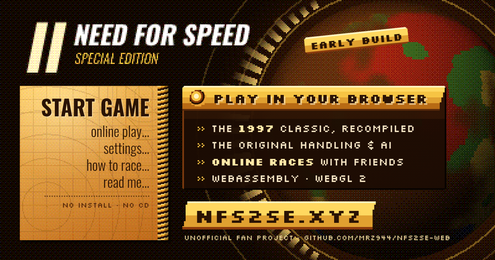
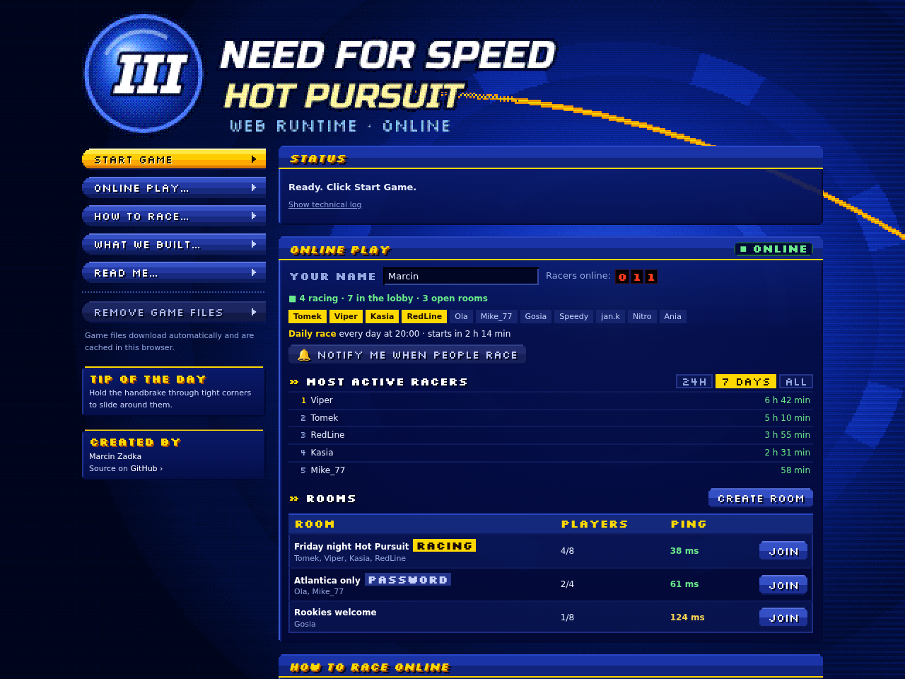
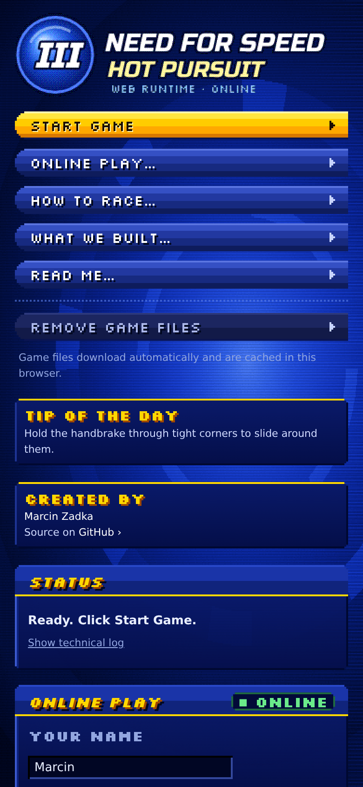
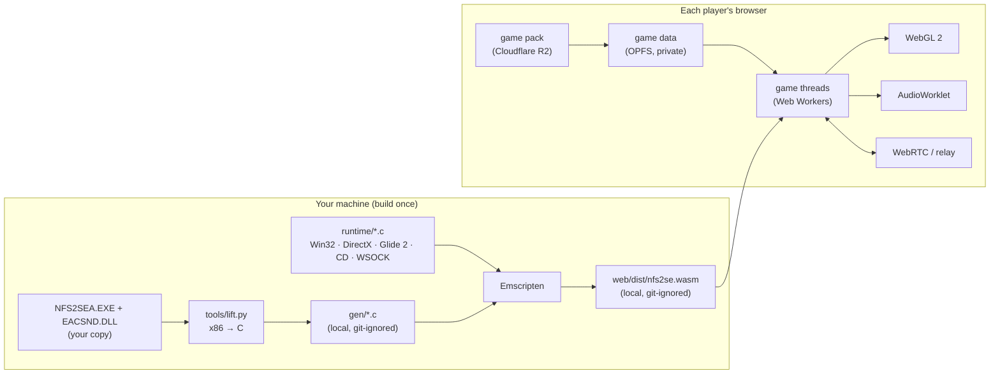

<div align="center">



# NFS II SE Web

**Need for Speed II: Special Edition, recompiled to run in your browser.**

Open the page, let the game download once, and race. **Play it at [nfs2se.xyz](https://nfs2se.xyz/).**


Also in your browser: **[nfs3.xyz](https://nfs3.xyz/)** (Need for Speed III: Hot Pursuit) ·
**[nfs4.xyz](https://nfs4.xyz/)** (Need for Speed: High Stakes)

</div>

---

## What is this?

NFS II SE Web takes the 1997 PC game, specifically the **3dfx version** of *Need for Speed II: Special
Edition* (`NFS2SEA.EXE` from the CD), and turns it into something a browser can run. It doesn't
emulate a PC, and it isn't a remake. It **statically recompiles** the game's own x86 code into C
and then into WebAssembly, so the real game logic, handling and AI run unchanged. Windows,
DirectX, the Voodoo card and the CD drive are replaced by a small runtime written for the web.

- 🏎️ **The real game.** The original code runs, recompiled, not reimplemented.
- 🎮 **Voodoo on your GPU.** The game's 3dfx Glide 2 path is redrawn with WebGL 2 and scaled up sharply.
- 💿 **No CD, no install.** The runtime plays the part of the Special Edition disc; the game files
  download once into the browser's private storage, from Cloudflare R2.
- 🌐 **Online rooms.** The lobby, rooms, invite links and the virtual IPX LAN from NFS3 Web are in
  place for the game's network mode (see *Status*).

This is the third game on the same runtime, after [NFS3 Web](https://github.com/mrz944/nfs3-web)
and [NFS4 Web](https://github.com/mrz944/nfs4-web).

## The original game, and what we added

| Untouched: the real NFS II SE | Added by this project |
|---|---|
| **Handling and physics.** Every car drives exactly like on a 1997 PC: the game's own code, recompiled, not rewritten or re-tuned. | **Static recompilation.** x86 machine code is lifted to C (`tools/lift.py`, Capstone) and built to WebAssembly with Emscripten. |
| **Cars, tracks and AI.** The original game data and opponent logic, the Special Edition cars and tracks included. | **Glide 2 on WebGL 2.** The Voodoo 1 API the game loads at run time (`glide2x.dll`): its fixed vertex layout, snapped coordinates and reversed texture codes, recorded per frame and replayed on the GPU. |
| **Music and sound.** The original soundtrack and effects through the game's own sound engine (`EACSND.DLL`). | **A virtual CD.** Drive `D:` is a CD-ROM labelled like the original disc, so the game finds its movies, music and tracks without one. |
| **Menus and modes.** Single Race, Tournament, Knockout, Showcase, as you remember them. | **Browser comfort.** One-time download into OPFS (resumable, from R2), AudioWorklet sound, mouse capture, frame pacing, page logs. |

**Runtime fixes for this game.** A few things NFS II SE expects from Windows and the Voodoo had to
be reproduced before it ran correctly:
- **one thread at a time:** the game was written for a single-core PC, and its movie player races
  its own file reader on a modern multi-core machine ("No DCT chunks found"). The runtime runs one
  game thread at a time, handing over at loop back-edges and blocking calls, the way Windows 95 did;
- **textures reloaded mid-frame:** the menus' pop-up dialogs load every backdrop tile into the same
  spot in texture memory and draw each one in between. A real Voodoo draws at once; a recorded frame
  is drawn later, so a reloaded texture now gets a fresh slot and the dialogs draw correctly;
- **car colours from palettes:** every car has its own palette, swapped many times a frame over the
  same textures. A Voodoo looks colours up as it draws; the runtime now keeps a copy of a texture
  per palette and switches when a palette is loaded after the texture was picked, so cars no longer
  flash another car's colours;
- **frames locked to the screen:** on a 60, 120 or 240 Hz display the game's frames follow the
  display's refresh instead of a separate 60 Hz timer, so no frame is shown twice or skipped;
- **cars in shadow:** the Voodoo's chroma key (black = see-through, used by the car textures) tests the
  texture's colour before lighting; testing the lit colour cut dark car texels away in shaded spots,
  so cars driving into a shadow lost their textures in black speckles;
- **brightness and fog:** the game sets the Voodoo's output gamma to 1.5 and draws every frame
  with two fog tables; both are now honoured, so night tracks are no longer too dark and murky;
- **threads that end give their memory back:** the game starts threads again and again (movies,
  races); each kept its stacks, which would run the browser build's fixed memory out in a long session;
- **free disk space** that fits the game's 32-bit arithmetic (a 4 GB answer wrapped to "less than 1 MB");
- **the CD and DirectX checks:** drive types, the volume label, and `DSETUP.DLL`'s version query;
- **an empty mouse poll yields:** the front end spins on the mouse while a loader thread works; the
  spinning thread now hands the single-core lock over instead of holding it for a whole time slice.

These fixes live in the runtime, not in the game's code or data.

## Screenshots

| Start page | On a phone |
|---|---|
|  |  |

> Screenshots show only this project's own pages. In-game footage is left out on purpose: the
> game's graphics belong to EA. The page's look (an amber drafting sheet, a dithered globe of
> made-up lands, gold banners, a pixel font) is drawn by the page itself; no EA logos or artwork
> are shipped.

## How it works



1. **Lifting.** `tools/lift.py` disassembles `NFS2SEA.EXE` and the sound DLL. Every guest function
   becomes a C function over a CPU struct; guest memory is one flat array at the PE's own addresses.
2. **Runtime.** `runtime/` reimplements the Windows APIs the game imports (files, threads, timers,
   windows, input), DirectSound, DirectInput, the CD drive, **Glide 2** (`runtime/glide.c`, drawn by
   the WebGL 2 renderer in `runtime/gpu.c`) and **WSOCK32** (IPX sockets on a virtual LAN).
3. **Browser.** Emscripten builds everything with threads (`SharedArrayBuffer`). The game files are
   read from the Origin Private File System, frames are drawn on the page's animation frame, and
   audio goes through an AudioWorklet.

More on the shared runtime is in [ARCHITECTURE.md](ARCHITECTURE.md); how the online races behave over real pings is in [docs/online.md](docs/online.md).

## Getting started

### What the host needs

- **The Need for Speed II: Special Edition CD (PC).** The build uses the 3dfx executable
  `NFS2SEA.EXE` (SHA-256 `1155f0a4…74b0`) and the CD's `FEDATA`, `GAMEDATA`, `EACSND.DLL` and
  `INSTALL.NFS` (saved as `install.win`), laid out as the installer would.
- **A Linux build machine** with `clang`, `python3`, SDL2 and Mesa (GLES/EGL) for the native build,
  and [Emscripten](https://emscripten.org/) for the web build.
- **Node.js 22+** for the server and lobby (no npm packages needed).
- **A recent Chrome, Edge, Firefox or Safari** with WebGL 2 for playing.

### Build

```sh
git clone https://github.com/mrz944/nfs2se-web.git && cd nfs2se-web
python3 -m venv .venv && .venv/bin/pip install capstone pefile

# your game folder in ./game (NFS2SEA.EXE, EACSND.DLL, FEDATA/, GAMEDATA/, install.win)
./build.sh game        # lift the game + native Linux build (debugging, headless tests)
./build-web.sh game    # browser build → web/dist/nfs2se.{js,wasm}
```

### Run

```sh
node web/serve.mjs 8092 --game game      # http://localhost:8092/
```

Open the page, wait for the game files to download (about 466 MB, once), then click **Start Game**.
Keyboard controls are the original ones. Click the picture to capture the mouse; Esc releases it.

> **Public hosting.** [nfs2se.xyz](https://nfs2se.xyz/) runs through a Cloudflare Tunnel to the
> local server ([docs/cloudflare.md](docs/cloudflare.md)), and the game files come from Cloudflare R2
> as a resumable gzip pack made by `tools/pack-game.mjs` ([docs/r2.md](docs/r2.md)).
> `web/game-source.json` points the page at the pack; without it the server sends the files itself.

## Native build and debugging

The native Linux build runs the same recompiled game in a window or headless, which makes most bugs
much easier to chase than in a browser.

| Variable | Purpose |
|---|---|
| `RT_HEADLESS=1 RT_DUMP=N RT_DUMP_DIR=dir` | no window, write every Nth frame as a PPM |
| `RT_INPUT="ms:KEY,ms:KEY+hold,ms:CLICK@x;y,…"` | scripted keyboard and mouse input |
| `RT_VERBOSE=1..3` · `RT_TRACE=addr,…` | runtime log (2: every import call) · trace lifted functions |
| `RT_WATCH_AT=s` | dump every thread and the single-core lock at that time |
| `RT_PROF=file` | sampling profiler (`tools/prof.py`) |
| `RT_FOG_LOG=1` · `RT_TEX_LOG=1..3` | log fog and gamma calls · texture conversions |
| `RT_PICK=x,y,from_s,every` · `RT_PICK_BOX=w,h` | log every draw covering a pixel (or box): texture, combine state, vertices |
| `RT_TEX_DUMP=1` | write each converted texture to `build/tex/` as a PPM |
| `RT_VSYNC=0` | don't pace `grBufferSwap` to 60 Hz |
| `RT_MULTICORE=1` | run game threads truly in parallel (the movie player may then fail) |
| `./re NFS2SEA.EXE dis\|func\|xref\|str …` | disassembler and cross-references for the exe |

## Status

- ✅ Intro movies, menus and dialogs, single races with keyboard and mouse, Glide 2 rendering, sound
- ✅ Browser build: automatic download from R2, start, menus and a race, tested in Chromium
- ✅ Online: lobby, virtual IPX LAN, two-player races natively and between two browsers, with NFS3's
  smoother play ported (each player's own car reacts like the host's; see [docs/online.md](docs/online.md))
- ✅ Your lobby name is your name in the game (filled in at CONNECT)
- ✅ Bonus cars (Bomber BFS, Tombstone, FZR 2000) and the Monolithic Studios track unlocked (Game Settings)
- ✅ Phones and tablets: on-screen touch controls; iPhones on iOS 18 can save the game files (OPFS
  worker), with an Add to Home Screen hint for fullscreen
- 🚧 Next: wider testing with more players and real internet links

## Credits

Made by **[Marcin Zadka](https://github.com/mrz944)**.

- Built on the runtime of [NFS3 Web](https://github.com/mrz944/nfs3-web), with parts from [NFS4 Web](https://github.com/mrz944/nfs4-web).
- The approach follows [nfsu2-web](https://github.com/th0mk/nfsu2-web), which did the same for *NFS Underground 2*.
- [NFSIISE](https://github.com/zaps166/NFSIISE) by zaps166 was a helpful reference for the Glide 2 and Windows details.
- [Capstone](https://www.capstone-engine.org/) and [Emscripten](https://emscripten.org/) make this possible.
- Site fonts: [Silkscreen](https://github.com/googlefonts/silkscreen) and [Oswald](https://github.com/googlefonts/OswaldFont), both under the SIL Open Font License (`web/fonts/`).

*Need for Speed* is a trademark of Electronic Arts. This is an unofficial fan project, not
affiliated with or endorsed by EA. Generated code, builds and game files are never committed.
